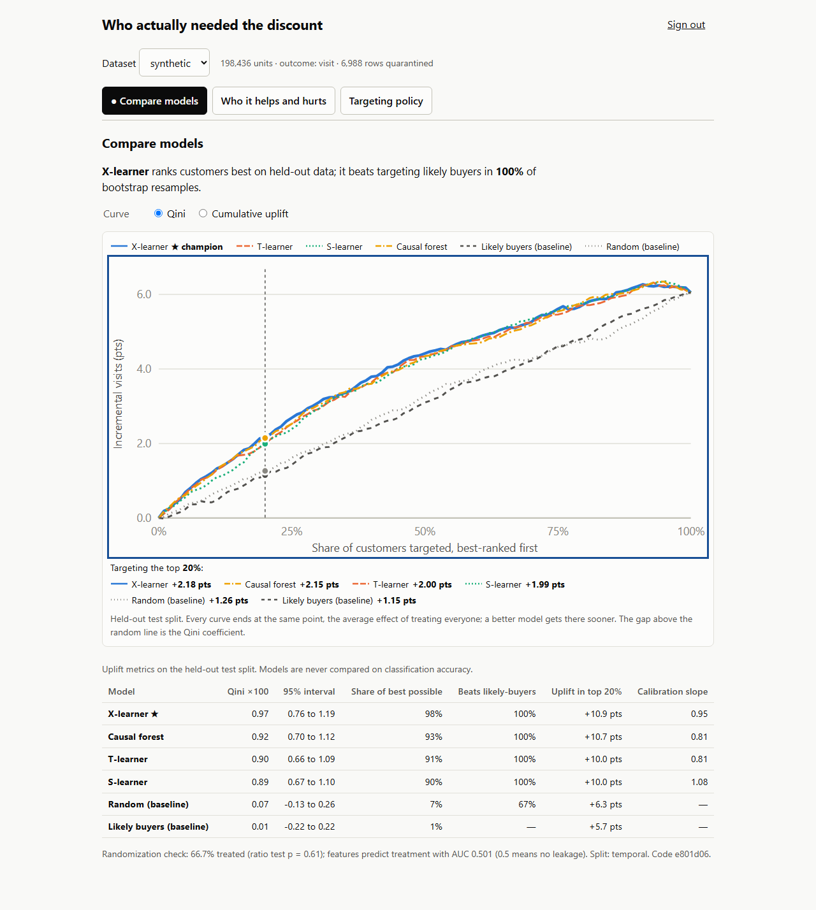
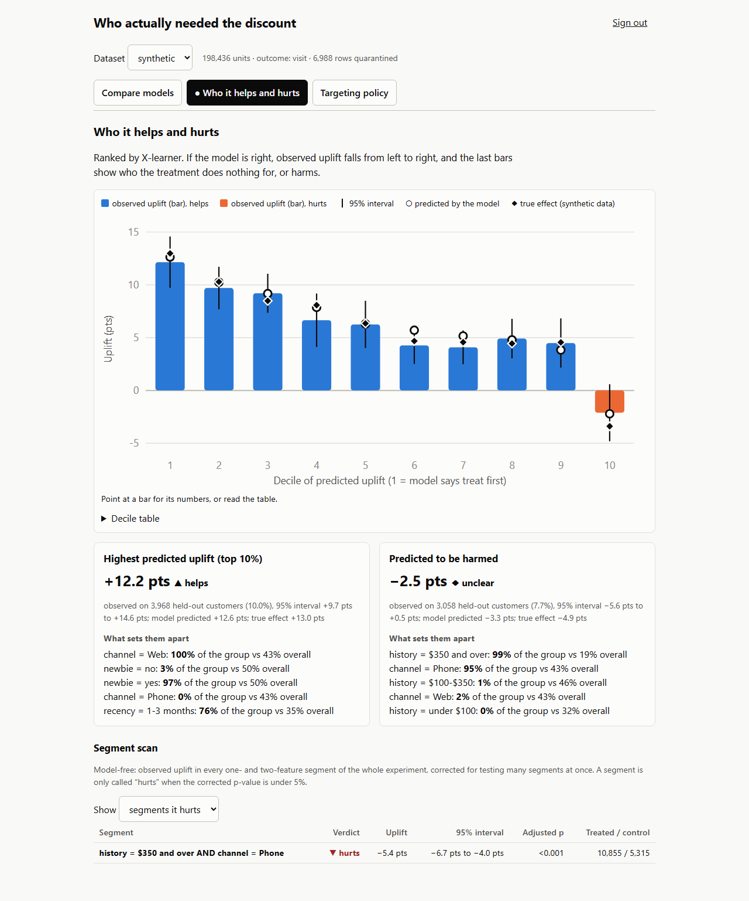
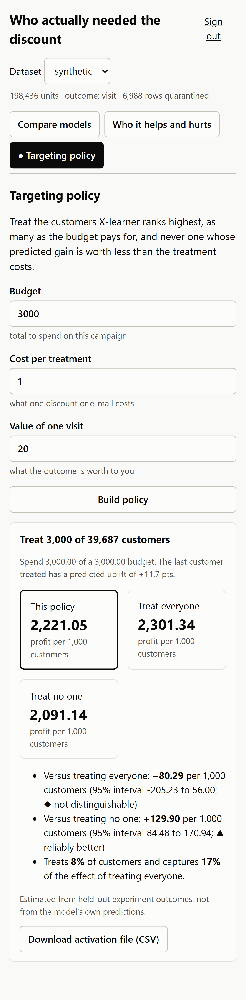
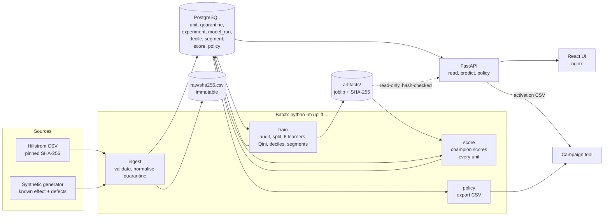

# Who actually needed the discount

Codetober day 17 · INFER · uplift modelling on randomized experiments

A promotion sent to everyone is mostly spent on people who would have bought anyway, and some of it on people it
puts off. This system takes a randomized experiment, trains several uplift learners on identical data, compares them
on Qini and uplift curves (never on classification accuracy), finds the segments the treatment hurts, and turns the
best model into a budget-constrained targeting policy that is valued against treating everyone and treating no one,
then exported for activation.

## What it found

All numbers are generated into [docs/evidence/model-report.md](docs/evidence/model-report.md) by
`scripts/report.py`; nothing below is typed from memory.

**Synthetic experiment with a known effect (198,436 units, 39,687 held out).**

| | test Qini x100 | share of the best possible |
|---|---:|---:|
| X-learner (champion) | 0.97 (0.76 to 1.19) | 98% |
| Causal forest | 0.92 | 93% |
| T-learner | 0.90 | 91% |
| S-learner | 0.89 | 90% |
| Random | 0.07 | 7% |
| "Likely buyers" response model | 0.01 | 1% |

- The model most teams already have, P(visit), ranks customers no better than random for this purpose.
- The generator hurts phone customers with over $350 of history. The model-free scan finds exactly that segment and
  no other: -5.4 points (-6.7 to -4.0), adjusted p = 8e-15.
- The champion predicts harm for 7.7% of held-out customers (the truth is 8.6%). Their true effect is -4.9 points.
  On the held-out outcomes alone the estimate is -2.5 (-5.6 to +0.5), so the system reports that group as
  `unclear`, not `hurts`: 3,058 units are not enough to confirm a 5-point harm, and it says so.
- With a budget for 30% of customers the policy earns +113 per 1,000 customers over treating everyone (+5 to +236)
  and captures 51% of the total effect. With an unlimited budget it still treats only 70%, and beats blanket
  treatment by +150 (+73 to +233).

**Hillstrom, the real experiment (64,000 units, 12,732 held out).** The honest result is a weak one.

- The S-learner is champion with Qini x100 of 0.37 (0.01 to 0.74). It beats the response model in 88% of bootstrap
  resamples, which is suggestive and not conclusive.
- No segment is reliably harmed. Of 170 segments tested, all 170 help; the smallest effect is +2.9 points.
- No budgeted policy is distinguishable from e-mailing everyone at a value of 20 per visit and a cost of 1. The
  e-mail helps nearly every kind of customer in this file, so there is little for targeting to win.

A model that does not clearly beat its baseline is reported as that. The UI says "no segment with statistically
reliable harm. That is a finding, not a gap."

## Screenshots

| Compare models | Who it helps and hurts | Policy, at phone width |
|---|---|---|
|  |  |  |

They are written by the end-to-end test (`UPLIFT_SCREENSHOTS=../docs/screenshots npx playwright test`), on a desktop
and a Pixel 7 viewport, so they cannot drift from the product.

## Architecture



| Layer | Where |
|---|---|
| Data | `uplift/ingest.py`, `uplift/synth.py`, `migrations/`, [data dictionary](docs/data-dictionary.md), [data profile](docs/data-profile.md) |
| Service | `uplift/learners.py` (T, S, X, causal forest), `uplift/metrics.py` (Qini, uplift curves), `uplift/policy.py`, `uplift/api.py` |
| Analytical | `uplift/segments.py` (harm identification), `uplift/policy.py` (value vs blanket treatment) |
| Interface | `web/src/` |
| Operational | `Dockerfile`, `docker-compose.yml`, `uplift/train.py` (training and batch scoring), `uplift/cli.py` |

## Run it

### With Docker

```bash
cp .env.example .env        # replace every CHANGE_ME
docker compose up --build   # db -> migrate -> batch (generate, ingest, train, score) -> api -> web
# http://localhost:8080 ; sign in with UPLIFT_ADMIN_TOKEN from .env
```

**Not verified on the development machine.** Docker Desktop's engine would not start there, so the compose stack has
never been brought up by me. It is exercised only by the `stack` job in `.github/workflows/infer.yml`, which builds
the images, starts the stack, runs `scripts/verify.sh`, the batch policy export, the browser journey and
`scripts/rollback-drill.sh`. That workflow has not run yet either: nothing has been pushed. Treat the Docker path as
written and unproven until that job is green.

### Without Docker (every command below was run)

Needs Python 3.11, Node 22 and a PostgreSQL you can create a database in.

```bash
python -m venv .venv && .venv/bin/pip install -e ".[dev]"      # Windows: .venv\Scripts\pip
export UPLIFT_DATABASE_URL=postgresql://USER@127.0.0.1:5432/uplift   # one URL is enough in dev
python -m uplift migrate
python -m uplift seed            # about 6 minutes: 200k synthetic units + Hillstrom, trained and scored
python -m uplift serve           # API on :8000, docs at /docs ; dev token: dev-only-token-change-me
cd web && npm ci && npm run dev  # UI on :5173
```

Each stage is its own idempotent command:

| Command | What it does |
|---|---|
| `uplift generate --units N --seed S` | Synthetic experiment, late-outcome file and a manifest of planted defects. |
| `uplift fetch` | Download Hillstrom (retries with backoff, verified against a pinned SHA-256). |
| `uplift profile FILE` | Profile a raw file against the ingestion contract. |
| `uplift ingest FILE --dataset NAME` | Validate into `unit` and `quarantine`. Same bytes twice is a no-op. |
| `uplift train --dataset NAME` | Audit randomization, split, train and evaluate every learner, pick a champion. |
| `uplift score --dataset NAME` | Champion scores every unit; replaces its own previous output. |
| `uplift policy --dataset NAME --budget B --cost C --value V --out FILE` | Create a policy and write the activation file. |
| `uplift retire EXPERIMENT` | Roll back: the previous complete experiment is served again. |

## Evidence for each requirement

| Requirement | Evidence |
|---|---|
| 1. Uplift metrics, never classification accuracy | `uplift/metrics.py` has no classification metric. `test_experiment_compares_every_learner_on_uplift_metrics` asserts none appears in the API; the UI test asserts none is a column. |
| 2. Segments where treatment hurts | `test_the_planted_harm_is_found_twice`: the scan flags the planted segment and nothing else. Model report, synthetic section. On Hillstrom the answer is "none", reported as such. |
| 3. Several learners, identical data, honest validation | One feature matrix and one split for all six; champion picked on validation, reported on test; paired bootstrap. The API test asserts every curve ends at the same test-split effect. |
| 4. Policy within a budget | Property test over 500 generated cases (`tests/test_policy.py`), a CHECK constraint on `policy`, `test_the_budget_guarantee_is_also_a_database_constraint`, and `verify.sh` counting the exported rows. |
| 5. Value vs treat-all and treat-none | `policy.evaluate`: three profits and paired 95% intervals from held-out experiment outcomes. `test_evaluation_recovers_a_known_policy_value` checks it against a world with a known answer. |
| 6. Validated where the truth is known | Share of oracle Qini, PEHE, true effect per decile, and true vs estimated policy value, all in the model report; gated in `tests/test_learners.py`. |

**The hard core, proved three ways.** (a) Differential: the T-, S- and X-learners here match EconML's to 1e-9 on
15,000 predictions. (b) Property-based: the Qini curve equals a brute-force reference that follows the definition,
depends only on the ranking, and ends at the average effect; the policy never exceeds its budget. (c) Failure
injection: a learner that raises, broken randomization, a crash mid-ingest, an unreachable database, a tampered
model file, a database outage under the API.

## Tests

```bash
export UPLIFT_TEST_ADMIN_URL=postgresql://postgres@127.0.0.1:5432/postgres   # integration tests need a real PostgreSQL
pytest                       # 166 tests, about 4.5 minutes
cd web && npm test           # 19 component tests
npx playwright test          # the primary journey, desktop and phone, against a real API and database
```

Without `UPLIFT_TEST_ADMIN_URL` the integration and API tests skip; the unit, property and model tests still run.
Last local result: 166 passed, 19 passed, 2 passed. CI (`.github/workflows/infer.yml`) runs lint, format check, mypy,
the OpenAPI drift check, all tests and the web build on every push; it has not run yet.

## Performance

Stated budget and what was measured ([timings](docs/evidence/timings.md), one laptop, PostgreSQL on the same host):

| Stage | Volume | Budget | Measured |
|---|---|---|---|
| Ingest | 202,414 rows | 60 s | 41 s (5.0k rows/s) |
| Train and evaluate 6 learners | 198,436 units | 5 min | 149 s (causal forest 47 s, bootstrap evaluation 45 s) |
| Batch score | 198,436 units | 60 s | 45 s (4.4k rows/s) |
| `GET` scores page / deciles | 100 rows | 100 ms | 12 to 17 ms |
| `GET` experiment (all curves) | 1 experiment | 500 ms | 280 to 430 ms |
| `POST /v1/policies` | 39,687 held-out units, 300 resamples | 3 s | 2.1 to 2.6 s |
| `POST` predict | 1 unit | 100 ms | 35 ms, after a 10 s first call that imports EconML and loads the model |

Index plans are in [explain-analyze.md](docs/evidence/explain-analyze.md): the score page takes 0.4 ms on
`score_ranked` and 178 ms without it.

**What breaks first at 10x (2M units).** Memory in `train.load_units`: it fetches every unit as a Python dict before
building a DataFrame, roughly 1 KB per unit, so 2M units is about 2 GB before any model is fitted, and `score` does
the same. The change is to read with a server-side cursor (or `COPY ... TO STDOUT`) into typed arrays in chunks and
score chunk by chunk. Second is the score insert, where two foreign-key checks cost 8 of every 12 seconds; at 10x
that is a `COPY` into a staging table and one validated `ALTER TABLE ... ADD CONSTRAINT` instead of row triggers.
The causal forest already trains on a seeded 60,000-row subsample. None of this is built.

## Reliability

| Dependency | When it fails | Behaviour |
|---|---|---|
| PostgreSQL, from a batch job | Not up yet or down | Retries at 0.5, 1, 2, 4, 8 s, then exits with "database unreachable after 6 attempts". |
| PostgreSQL, from the API | Down | `503 database_unavailable` with `Retry-After: 5`; `/readyz` fails, `/healthz` stays up; recovers without a restart. |
| Hillstrom download | Unreachable or wrong hash | 5 attempts with backoff capped at 8 s. `seed` then continues on synthetic data and logs why; `fetch` exits with instructions. |
| Model artifact | Missing or modified | `503 model_unavailable` for predict; everything else keeps working. Never unpickled if the hash differs. |
| One learner | Raises during fit | Recorded as failed with its error; the others complete; the UI shows a "partial results" banner. |
| Ingest | Process dies mid-file | The file's transaction rolls back; the next run is a clean first load. |
| API, from the UI | Unreachable | Two retries with backoff, then an error with a retry button; if results were already loaded they stay on screen marked stale. |

## Security

- Every `/v1` path requires a bearer token, compared in constant time; only the admin token creates or exports
  policies. Tested on all ten paths with missing, wrong and malformed tokens.
- Input is validated by schema at the API boundary (unknown fields refused, sizes bounded) and by `normalize()` at
  the file boundary. All SQL is parameterized.
- Secrets come from the environment; the service refuses to start outside `UPLIFT_ENV=dev` with the development
  tokens. Three database users: owner (migrations), batch (data, no DDL), api (read, insert policies only), tested in
  `test_least_privilege`.
- Containers run as a non-root user with all capabilities dropped; the API's filesystem and its artifact volume are
  read-only.

## Observability

- JSON logs, one `correlation_id` per HTTP request (yours if you send `X-Request-ID`) or batch command.
- `/metrics`: request counts by route and status, latency histograms, policies created, units predicted, database
  outages. Not exposed through nginx.
- `/healthz` is liveness. `/readyz` runs a query against the migrated schema and checks the artifact store.
- Every stage appends its duration and result to `run_report.jsonl`; `experiment.timings` keeps the breakdown.

## API

The reference is generated from the code: [docs/openapi.json](docs/openapi.json), and live at `/docs`. CI fails if
the committed file differs from what the code produces.

| | |
|---|---|
| `GET /v1/datasets` | Datasets, quarantine counts by reason, staleness. |
| `GET /v1/datasets/{name}/experiment` | Every learner's metrics and curves. |
| `GET /v1/runs/{id}/deciles`, `/profiles` | Predicted vs observed by decile; high-uplift and predicted-harm groups. |
| `GET /v1/experiments/{id}/segments` | Segment scan; cursor-paginated, filter by verdict. |
| `GET /v1/runs/{id}/scores` | Scored units; cursor-paginated on `(uplift, unit_id)`. |
| `POST /v1/runs/{id}/predict` | Uplift for up to 1,000 units. |
| `POST /v1/policies` | Create a policy. Requires `Idempotency-Key`; a retry returns the same policy with 200. |
| `GET /v1/policies/{id}`, `/export` | The policy; the activation CSV. |

Errors are always `{"error": {"code", "message", "request_id", "details"?}}`.

## Operating it

**Deploy.** Set `UPLIFT_IMAGE_TAG` and `UPLIFT_CODE_VERSION` to the commit, then `docker compose up --build -d`.
`migrate` and `batch` run to completion before the API starts. Check with
`scripts/verify.sh http://HOST:8080 READ_TOKEN ADMIN_TOKEN` (23 checks over HTTP; passing output from the local,
non-Docker stack is in [docs/evidence/verify-local.txt](docs/evidence/verify-local.txt)).

**Roll back a model.** `docker compose run --rm batch retire EXPERIMENT_ID`. The previous complete experiment, its
scores and its artifacts are served again immediately; nothing is deleted. Done by hand against the local stack in
[docs/evidence/rollback-local.txt](docs/evidence/rollback-local.txt); `scripts/rollback-drill.sh` does it against
compose and has not been run yet (see the Docker note above).

**Roll back code.** Start the previous image tag: `UPLIFT_IMAGE_TAG=<previous> docker compose up -d`. If the release
included a migration, first `docker compose run --rm migrate migrate -1`; every migration has a downgrade and
`test_migrations_roll_back_and_forward` runs them.

**Back up.** Two things hold state. The database:
`docker compose exec db pg_dump -U uplift_owner -Fc uplift > uplift.dump` (restore with `pg_restore -d uplift`).
The `uplift-data` volume: `raw/` is the source of truth for every derived table and `artifacts/` holds the models;
archive the volume. With `raw/` alone, `ingest` + `train` + `score` rebuild everything, and the same seed reproduces
the same metrics (the two full runs behind this README produced identical Qini values).

## Limitations

- **The Docker stack and CI are unverified.** See above. Everything else in this README was run.
- **One real dataset, and it is small and old.** Hillstrom is 64,000 customers from 2008. The result there is weak,
  and the system says so. Criteo-UPLIFT is not ingested.
- **Binary treatment only.** "Any e-mail" vs none. Which e-mail, or how large a discount, is a different problem.
- **Randomized data only.** Propensity is taken as the treated share. Observational data would be refused by the
  audit, not corrected.
- **The policy's population is the held-out test split**, standing in for a future audience. There is no path yet
  for scoring a brand-new file of eligible customers in batch; `POST .../predict` does it 1,000 at a time.
- **Intervals understate uncertainty.** They resample the evaluation data with the model fixed. They do not include
  the variance of retraining, and the champion is the best of four on one validation split.
- **Small harmed groups cannot be confirmed on held-out data alone.** The 7.7% predicted-harm group on synthetic
  data is truly harmed and still reads `unclear`. The whole-experiment scan is the stronger test.
- **The segment scan only sees one- and two-feature segments with at least 300 units per arm.** Harm that needs
  three features to describe will be diluted or missed.
- **Forest predictions are reproducible to about 1e-13, not bit for bit** (trees are summed on two threads).
- **No hyperparameter tuning, no scheduled retraining, no drift monitoring, no rate limiting.**
- **The first prediction after an API start takes about 10 seconds**, and policy creation takes about 2 seconds;
  the UI states what it is doing meanwhile.
- **Money is unit-free.** Value and cost are numbers in one currency you choose; nothing converts or rounds them.

## Layout

```
uplift/        package: config, db, synth, ingest, profile, learners, metrics, segments, policy, train, api, cli
migrations/    Alembic, hand-written SQL, each with a downgrade
tests/         unit and property (metrics, policy, ingest), model (learners), integration (pipeline, api)
web/           React + Vite UI, component tests, Playwright journey
scripts/       verify.sh, rollback-drill.sh, explain.py, report.py
deploy/        nginx.conf, init-roles.sh
docs/          data profile, data dictionary, openapi.json, evidence/, screenshots/
DECISIONS.md   what was chosen, rejected, and not built
```
