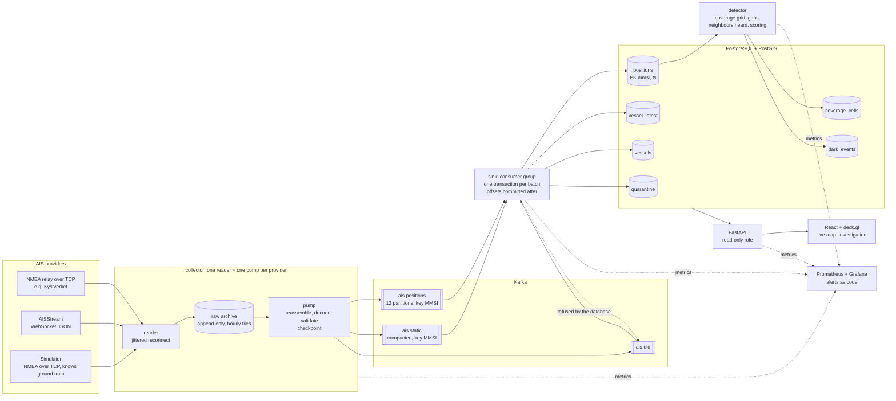

# GHOST FLEET

Track ships in real time from AIS, and catch the ones that switch off their transponders and vanish.

Async collectors hold long-lived connections to AIS providers, decode NMEA sentences and push positions
into Kafka. A consumer group deduplicates them into PostGIS. A gap detector separates receiver coverage
holes from vessels that deliberately went dark, and scores reappearances that would have needed an
impossible speed. A deck.gl map shows the live fleet and replays any vessel's track.


**Status in one paragraph.** The pipeline, detector, API and UI run and are tested end to end (140 Python
tests against real PostGIS and Kafka, 21 component tests, a browser journey at desktop and phone width).
It has only ever ingested the bundled simulator and a recorded real capture: the live public feed was
unreachable from the build network and no AISStream key was available. The Docker stack and deployment
scripts are written but have never been run, because Docker would not start on the development machine,
and CI has not yet run. Details under [Limitations](#limitations).

## Architecture



The archive is the write-ahead log: the reader never waits on Kafka, and the pump resumes from a
checkpoint, so a crash, a restart or a Kafka outage loses nothing that reached the socket. Delivery is
at-least-once; the `(mmsi, ts)` primary key makes the rows effectively-once.

## Run it

### With Docker (written, not yet run)

```bash
cd INGEST
cp .env.example .env          # set the passwords
docker compose up --build
```

This is meant to migrate the database, create the topics, start a simulator relay with 3,000 ships, push
six hours of generated history through the full pipeline, and start every service.

| What | Where |
|---|---|
| Map and API | http://localhost:8000 |
| API reference (generated) | http://localhost:8000/docs |
| Grafana (user `admin`, password from `.env`) | http://localhost:3000 |
| Prometheus | http://localhost:9090 |

The first dark events should appear once the detector has seen the seeded history, a minute or two after
the `seed` container exits. To use real feeds, set `GHOST_SOURCES` (and `AISSTREAM_API_KEY`) in `.env`.

### Without Docker (verified)

These are the commands the system was built and verified with. They need Python 3.11, Node 22, a
PostgreSQL with PostGIS, and (for the streaming path) a Kafka broker.

```bash
cd INGEST
python -m venv .venv && . .venv/bin/activate        # Windows: .venv\Scripts\activate
pip install -e ".[dev]"
export GHOST_DSN=postgresql://postgres@127.0.0.1:5432/ghost      # an empty database you own

python -m ghostfleet migrate
python -m ghostfleet seed-db --ships 1200 --hours 6     # simulated history straight into PostGIS, no Kafka
(cd web && npm ci && npm run build)
python -m ghostfleet api                                 # http://127.0.0.1:8000
```

The streaming path, each in its own terminal, with `GHOST_KAFKA=127.0.0.1:9092` set:

```bash
python -m ghostfleet topics
python -m ghostfleet sim --serve 127.0.0.1:5631 --ships 3000 --step 20
GHOST_SOURCES="sim_a=tcp://127.0.0.1:5631,sim_b=tcp://127.0.0.1:5631" python -m ghostfleet collect
python -m ghostfleet sink
python -m ghostfleet detect
```

Every stage is a subcommand and runs on its own: `python -m ghostfleet --help`.

## Test it

```bash
ruff check . && ruff format --check . && mypy
pytest                                    # unit tests; integration tests skip without the two variables below
GHOST_TEST_DSN=postgresql://postgres@127.0.0.1:5432/ghost_test GHOST_TEST_KAFKA=127.0.0.1:9092 pytest
cd web && npm run typecheck && npm test && npm run build
GHOST_DSN=<a seeded database> npm run e2e           # needs Chrome; starts the API itself
```

`GHOST_TEST_DSN` must point at a scratch database: the suite migrates it down to nothing and back up.

| Kind | What it covers |
|---|---|
| Unit | Decoder against published reference sentences and by round trip; reassembly edge cases; the timestamp key; validation table; backoff; every classification and scoring rule; the simulator's determinism |
| Real sockets and files | Reconnect against a relay that hangs up and goes silent; archive rollover; checkpoint resume after Kafka dies mid-batch |
| Integration (PostGIS, Kafka) | Migrations down and up; idempotent replay; constraints refusing bad rows; poison messages; detector accuracy floor; late data withdrawing an event; index usability |
| Data | Row counts against ground truth, uniqueness, referential integrity, distribution bounds |
| API | Every endpoint: success, validation failure, malformed input, 404, read-only, database down |
| Failure injection | The sink process is killed mid-batch and restarted: nothing lost, nothing duplicated |
| Component and end to end | Loading, empty, error, stale and partial states; keyboard paths; the primary journey in a browser at desktop and phone width; frame times with 20,000 vessels |

CI (`.github/workflows/ingest.yml` at the repository root) is set up to run all of it on every push, with
PostGIS and Kafka as service containers; a missing dependency fails the build instead of skipping.

## Evidence

| Claim | Measured | Where |
|---|---|---|
| Dark periods are told apart from coverage gaps | precision 0.870, recall 0.923 against simulator ground truth (324 silences) | [docs/evidence/detection.md](docs/evidence/detection.md) |
| Impossible reappearances are flagged | 27 of 27, none without cause | same |
| Ingest latency within a 2 s p95 budget | p95 0.87 s at 1,000 reports/s, 1.26 s at 2,000; saturates before 3,000 | [docs/evidence/performance.md](docs/evidence/performance.md) |
| Thousands of moving vessels without dropped frames | 20,000 vessels, p95 frame 14.1 ms | same |
| Every index earns its place | `EXPLAIN ANALYZE` per index | [docs/evidence/explain.md](docs/evidence/explain.md) |
| Each functional requirement | test names and a live run | [docs/evidence/requirements.md](docs/evidence/requirements.md) |

These were measured on a memory-starved laptop with everything on one machine, and the detection figures
describe a simulated world. Both documents say what the numbers do not show.

## Documentation

- [What the real data looks like](docs/data-profile.md): the profile that the schema and validator were designed from
- [Decisions log](docs/decisions.md): what was chosen, what was rejected, what was deliberately not built
- [Data dictionary](docs/data-dictionary.md): every table, column, unit and nullability
- [Operations](docs/operations.md): deploy, roll back, back up, behaviour under each partial failure
- [API reference](docs/openapi.json): generated from the code and checked in CI; browsable at `/docs` on a running API
- Configuration: [.env.example](.env.example)

## Layout

```
ghostfleet/
  nmea.py        NMEA framing, multi-part reassembly, AIS payload decode (and encode, for the simulator)
  validate.py    boundary validation, the timestamp key, MMSI to flag
  collectors.py  provider readers, raw archive, checkpointed pump, replay
  bus.py         Kafka topology and clients
  sink.py        consumer group: idempotent writes, dead letters
  detect.py      coverage grid, gap detection, classification, scoring
  api.py         HTTP API
  simulate.py    seeded AIS world with ground truth
  evaluate.py    detection scoring, load test, dead-letter replay, direct seeding
  obs.py         structured logs, metrics
  db.py          pool and migration runner
  migrations/    numbered .up.sql / .down.sql pairs
web/             React + deck.gl UI, component and end-to-end tests
ops/             Prometheus, alert rules, Grafana dashboard, deploy and backup scripts
tests/           Python tests
docs/            evidence, decisions, dictionary, operations, OpenAPI
```

## Limitations

**Not exercised against live real-world feeds.** The Norwegian Coastal Administration's open NMEA feed
timed out from the build network, and no AISStream API key was available. The NMEA path is verified on
85,194 recorded real sentences; the AISStream mapping is tested only against the message shape in its
documentation. Expect surprises on first contact with either.

**Not deployed, and the Docker stack has never been run.** No cloud account was available and Docker would
not start on the development machine. The Dockerfile, compose file, and the deploy, rollback and backup
scripts are unexecuted. The application itself was run natively.

**CI has not been observed green.** The workflow was written but nothing has been pushed.

**Detection accuracy is measured on a simulator.** Real coverage is ragged and weather-dependent; real
evasion includes spoofed positions and swapped identities, which are not modelled or detected. The system
cannot tell a transponder that was switched off from one that failed.

**"Every ship on Earth" depends on the providers.** Terrestrial receivers reach about 40 nautical miles
from shore. Without a satellite AIS provider the open ocean is one large coverage gap, and the detector
will (correctly) refuse to call anything there dark.

**Known gaps in the detector**
- Silences longer than the 72 hour lookback are not seen.
- A partial receiver outage with another receiver nearby is misread as good coverage (4 false alarms in the evaluation).
- A quiet but well-covered sea lane scores as poorly covered, so dark vessels there are missed.
- Two ships sharing one MMSI produce a stream of `position_jump` events; they are not recognised as an identity conflict.
- Coverage reliability is a single number per cell over the whole window; it does not vary by time of day.

**Timestamps.** Position time is reconstructed from the report's second-of-minute. A report delayed more
than 55 seconds is stamped one minute late; the 2% of reports with no UTC second use the receive second,
so two providers can disagree by a second and store it twice.

**Identity is self-reported.** Names, call signs and types are whatever the vessel transmits. There is no
external registry behind them beyond the flag state implied by the MMSI.

**Scale.** One sink process saturates between 2,000 and 3,000 positions per second on the test machine.
`positions` is not partitioned and has no retention job: it grows until someone deletes from it.
Single-node Kafka with replication factor 1: a lost disk loses whatever was in flight (the archive can replay it).

**Security.** No authentication or rate limiting on the API (it is read-only and public by design; put it
behind a proxy). Kafka and the service-to-database links are plaintext inside the compose network.

**Interface.** The map canvas itself is not operable by screen reader; the event list, search and
investigation panel provide the same information and are keyboard accessible. There is no basemap beyond a
coarse coastline, so harbours and straits are not recognisable when zoomed in. Colour contrast was chosen
to meet WCAG AA but was not audited with a tool.

**Alerts go nowhere.** Rules are defined and evaluated by Prometheus; no Alertmanager routes them to a person.
