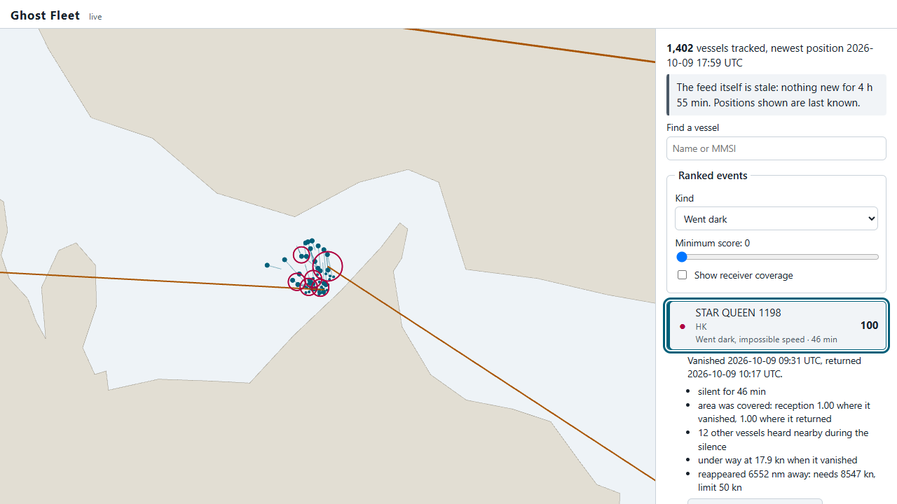
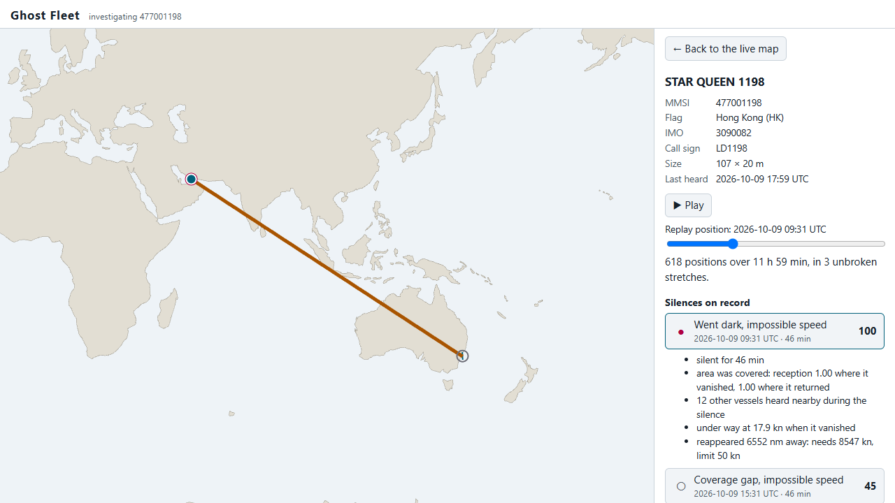

# Evidence for each functional requirement

Each requirement, what demonstrates it, and how to rerun it. Test names are in `tests/` unless noted.

## 1. Reconnect to every provider with jittered exponential backoff and lose nothing on restart

| Evidence | Where |
|---|---|
| Backoff doubles from the base, caps, resets, and is fully jittered (uniform from 0 to the ceiling) | `test_backoff_is_exponential_capped_and_fully_jittered` |
| A real TCP relay that hangs up after every burst and goes silent once: the reader reconnects each time (including by idle timeout) and every line sent is in the archive | `test_reader_reconnects_with_backoff_and_archives_every_line` |
| An unreachable provider is retried indefinitely, paced, without spinning | `test_reader_keeps_trying_while_the_provider_is_unreachable` |
| Kafka dies mid-batch; a fresh process resumes from the checkpoint; the union of what was delivered equals a clean run, and the restart did not start over | `test_pump_resumes_from_checkpoint_after_kafka_dies_mid_batch` |
| A multi-part message split across a restart is still delivered, because the checkpoint never passes a fragment waiting for its sibling | `test_checkpoint_waits_for_a_fragment_still_missing_its_sibling` |

**Live run** (simulator relay dropping every client every 15 seconds, two providers, 65 seconds):

```
ghost_provider_connects_total{outcome="ok",source="sim_a"} 3.0
ghost_provider_connects_total{outcome="failed",source="sim_a"} 2.0
ghost_provider_connects_total{outcome="ok",source="sim_b"} 3.0
ghost_provider_connects_total{outcome="failed",source="sim_b"} 2.0

{"level": "WARNING", "msg": "provider down, reconnecting", "source": "sim_b", "error": "ConnectionError('closed by peer')", "retry_in_s": 0.21}
{"level": "WARNING", "msg": "provider down, reconnecting", "source": "sim_a", "error": "ConnectionError('closed by peer')", "retry_in_s": 0.53}
```

The two providers lost their connections in the same millisecond and came back at different, random delays.

Scope of "lose nothing": everything a provider delivered to the socket survives crashes, restarts and Kafka
outages. What a provider broadcast while we were disconnected from it cannot be recovered from that
provider; overlapping providers are the mitigation.

## 2. Reassemble multi-part sentences before decoding; drop incomplete fragments after a timeout

| Evidence | Where |
|---|---|
| The reference two-part type 5 message from the AIVDM protocol documentation decodes to the documented vessel (EVER DIADEM, IMO 9134270) | `test_multipart_static_reference_vector` |
| An incomplete group survives until the timeout and is handed back, with its lines, just after | `test_incomplete_fragment_is_dropped_after_timeout_not_before` |
| Orphan second fragments, reused sequence ids, interleaved messages, and a bound on pending groups | `test_second_fragment_without_first_is_an_orphan` and the three tests after it |
| Dropped fragments are quarantined with the original line, and release the checkpoint | `test_stale_fragment_is_quarantined_and_releases_the_checkpoint` |
| On 85,194 real sentences: 4,844 fragments reassembled, 2 incomplete groups and 2 orphans quarantined | [data-profile.md](../data-profile.md) |

## 3. Idempotency: replaying an archived window creates no duplicate positions

| Evidence | Where |
|---|---|
| Six simulated hours loaded twice: second load inserts 0 rows, and every row's `ingested_at` is unchanged | `test_replaying_the_same_window_creates_no_duplicates` |
| The same archive replayed twice through real Kafka into real PostGIS: identical row counts, identical quarantine | `test_archive_replayed_twice_through_kafka_stores_each_position_once` |
| The sink process is SIGKILLed mid-batch and restarted: final counts equal ground truth, no duplicate keys | `test_killing_the_sink_mid_batch_loses_nothing_and_duplicates_nothing` |
| Two receivers hearing one transmission up to 50 seconds apart derive the same key (2,000 random cases) | `test_two_receivers_hearing_one_transmission_agree_on_the_key` |

**Live run**, two providers carrying identical traffic: 1,515 positions stored, 1,621 dropped by the key
(`ghost_positions_duplicate_total`), 0 duplicate `(mmsi, ts)` keys in the table.

## 4. Separate coverage gaps from transponder-off behaviour, and prove the distinction

[detection.md](detection.md): against simulator ground truth, precision 0.870 and recall 0.923 for `dark`,
with the confusion matrix, a threshold sweep, and an account of every kind of error. Rules are unit-tested
case by case in `test_rules.py` (`test_silence_in_covered_water_with_neighbours_heard_is_dark` onwards);
CI holds a floor of 0.8 on both in `test_detector_separates_dark_from_coverage_and_is_idempotent`.

## 5. Flag reappearances that would require impossible speed

| Evidence | Where |
|---|---|
| Boundaries: 49.9 kn over an hour is possible, 50.1 kn is not; 600 kn over 5 nm is GPS jitter, not a teleport | `test_speed_limit_boundaries` |
| An impossible reappearance is flagged, explained in words, and outranks every ordinary dark period | `test_impossible_reappearance_is_flagged_and_outranks_everything` |
| End to end: 27 of 27 simulated teleports flagged, none flagged without cause | [detection.md](detection.md) |

## 6. Render thousands of moving vessels without dropping frames

[performance.md](performance.md): 20,000 moving vessels, p95 frame time 14.1 ms, 2 of 1,022 frames over
33 ms while zooming and panning. Measured by `web/e2e/journey.spec.ts`; rerun with `npm run e2e`.

## Screenshots of the primary journey

Captured by the end-to-end test from the running system.




