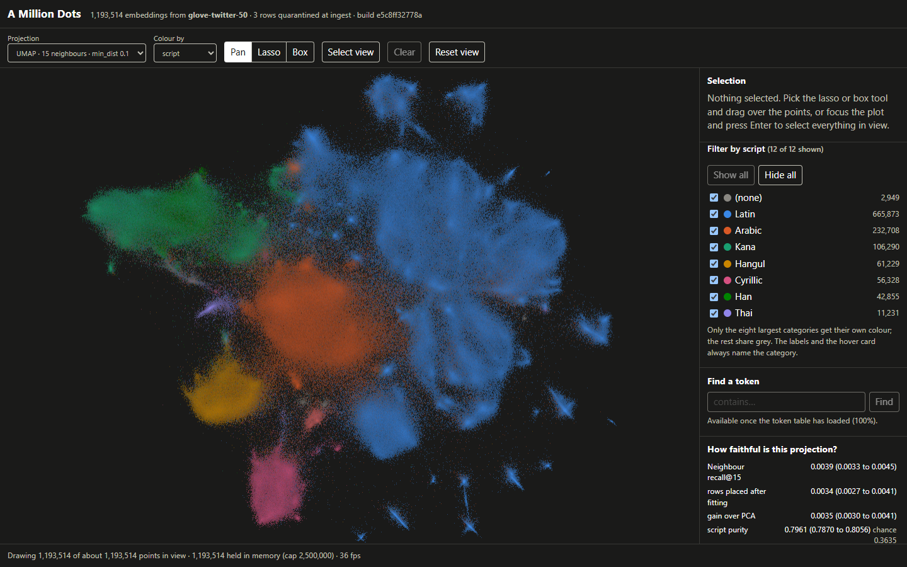
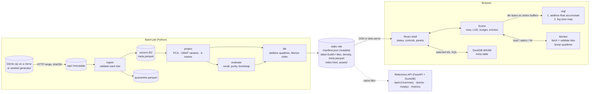

# A Million Dots

Codetober: RENDER. Every point of a 1.19-million-token embedding space, drawn on the GPU, with a
lasso that reports statistics while the mouse button is still down.



A batch pipeline projects the vectors to 2-D (PCA as the baseline, UMAP variants) and cuts each
projection into level-of-detail tiles served as binary buffers. The page draws them with regl as
instanced triangles into a floating-point target and tone-maps the accumulated density. A web worker
holds a quadtree over the loaded points for hover and lasso; DuckDB-WASM holds the metadata and
describes the selected tokens. After the files are downloaded, nothing talks to a server.

- [Evidence for each requirement](#evidence)
- [Run it](#run-it)
- [Architecture](#architecture)
- [Projection quality](#projection-quality)
- [Operations](#operations): deploy, verify, roll back, back up
- [Limits](#limits)
- [Decisions](docs/DECISIONS.md) · [Data dictionary](docs/DATA_DICTIONARY.md) · [API reference](docs/openapi.json)

## Evidence

Measured on the real dataset (GloVe-Twitter 50-d, 1,193,514 points) by
[`web/scripts/measure.mjs`](web/scripts/measure.mjs), which drives the published static site in
Chrome through the same object the user drives. Three runs, all committed:
[`results/glove-twitter-50/perf-run1.json`](results/glove-twitter-50/perf-run1.json), `-run2`, `-run3`.
Machine: a laptop with integrated graphics (Intel Iris Xe, Direct3D 11 through ANGLE), 16 GB,
a 72 Hz panel, 1110 x 756 canvas at device pixel ratio 1. Ranges below are across the three runs.

| # | Requirement | Result | Evidence |
|---|---|---|---|
| 1 | 60 fps pan and zoom with a million points | **Partly met on this GPU.** Between 1,182,429 and 1,193,514 points are drawn in every frame (the pass pans a little of the data off screen); nothing is thinned out while moving. Over six 10-second scripted pan-and-zoom passes the mean was 58.5 to 66.5 fps (at or above 60 in four of six); the median frame is one refresh (13.9 ms), but 8 to 22% of frames took two (27.8 ms). With the GPU forced to finish each frame the cost is 15.6 to 19.9 ms, against 16.7 ms for a steady 60 | `panZoom` in the perf files. Where the time goes and what was tried: decision R7 |
| 2 | Lasso statistics in under a second | **Met for the counts, not always for the token list.** Count, per-category counts, purity, entropy and lift arrive 36 to 165 ms after the outline closes, for selections of 6,049 to 1,085,642 points, and during a drag (median 51 to 61 ms, worst 201 ms), so they are on screen before the button is released. The token statistics from DuckDB-WASM take a further 236 to 871 ms; from outline to token list is 0.38 to 1.55 s, over one second in 5 of 15 measurements | `lasso` and `liveDrag` in the perf files; the end-to-end test asserts a count is shown while the mouse is still down |
| 3 | Density shading, not alpha stacking | Points accumulate additively into a floating-point target; a second pass maps `log(1 + weight) / log(1 + reference)` to lightness and the weighted mean colour to hue | [density view](docs/screenshots/overview-density-dark.png), [by script](docs/screenshots/overview-script-dark.png), [light theme](docs/screenshots/overview-script-light.png); `web/src/lib/renderer.ts`; decision R1. Not covered by an automated test |
| 4 | Progressive loading, quick first view | First points on screen 1.7 to 2.1 s after navigation with a cold cache (at least the root tile: 32,768 points, 393 KB). The other 91 tiles (13.7 MB in all) follow within 0.6 to 0.8 s, coarse levels first. DuckDB-WASM and the 22.8 MB token table start downloading only after the first frame and are ready about 10 s after navigation, with a progress bar meanwhile | `load` in the perf files. Local server, so network time is not represented |
| 5 | Memory bounded by tiling | With a budget of 300,000 points (a quarter of the dataset) and 40 random views at five zoom levels, at most 372,707 points were ever held, under the 375,000 cap; JavaScript heap stayed under 32 MB | `boundedMemory` in the perf files; property tests in `web/src/lib/lod.test.ts` assert the bound on a 5.5-million-point tree |
| 6 | Selection linked to metadata filtering, no server | The end-to-end test records every request the page makes during a lasso, the token query and a category filter, and requires the list to be empty. The measured site was served by `python -m http.server`: there was no API to call | `web/e2e/journey.spec.ts`, run against the static site |

Batch stages on the same machine, measured by the stages themselves
([`results/glove-twitter-50/`](results/glove-twitter-50/)):

| Stage | Volume | Time | Throughput |
|---|---|---|---|
| fetch | 199 MB compressed, 511 MB of text | 78 s | 2.5 MB/s (network) |
| ingest | 1,193,517 lines | 95 s | 12,600 lines/s |
| k-means, k=24 | 1,193,514 x 50 | 19 s | |
| PCA | 1,193,514 rows | 1.9 s | 643,000 rows/s |
| UMAP n=15: fit 100,000, place 1,093,514 | | 277 s + 964 s | 1,134 rows/s placed |
| UMAP n=50: fit 100,000, place 1,093,514 | | 837 s + 3,029 s | 361 rows/s placed (other jobs were running) |
| evaluate | 4,000 queries, exact neighbours among 1.19M, three variants | 137 s | |
| tile | 3 variants, 245 tiles, 43 MB + 22.8 MB metadata | 16 s | 224,000 points/s |

## Run it

### Docker

```bash
cd RENDER
cp .env.example .env
docker compose up --build        # http://localhost:8015
```

`pipeline` generates a 200,000-point synthetic dataset, projects and tiles it into a volume, and
exits; `app` then serves the page, the tiles and the reference API. Set `DOTS_SOURCE=auto` in
`.env` for the real data (a 199 MB download and about an hour of projection).

**Not verified on the machine this was built on**: its Docker engine would not start. The
commands the two images run are the ones below, which were.

### Without Docker

Python 3.11 and Node 22.

```bash
cd RENDER
python -m venv .venv && . .venv/bin/activate      # Windows: py -3.11 -m venv .venv; .venv\Scripts\activate
pip install -e ".[ml,dev]"

export DOTS_SOURCE=synth DOTS_SYNTH_ROWS=200000   # or DOTS_SOURCE=auto for the real data
python -m dots all                                # fetch, ingest, project, evaluate, tile, report

cd web && npm ci && npm run build && cd ..
python -m dots serve                              # http://127.0.0.1:8015
```

For front-end work: `python -m dots serve` in one terminal, `cd web && npm run dev` in another
(Vite forwards `/data` and `/api` to the API).

Every stage runs on its own and skips itself when its outputs are current:

| `python -m dots ...` | |
|---|---|
| `fetch` | Download the one archive member needed over HTTP range requests, or generate. Writes `raw/` once, with sha256 |
| `ingest` | Validate every line; accepted rows to `vectors.f32` + `meta.parquet`, the rest to `quarantine.parquet` with a reason. Writes a data profile |
| `project` | k-means labels, PCA, and each UMAP variant (fit on landmarks, place the rest) |
| `evaluate` | Neighbour recall and label purity per variant against chance and PCA, with bootstrap intervals; appends to `experiments.jsonl` |
| `tile` | Level-of-detail tiles, density grids, browser metadata, manifest |
| `report` | Copy every stage's measurements into `results/<source>/` |
| `serve` | Reference API + static files |
| `publish <dir>`, `verify <url>`, `rollback` | [Operations](#operations) |
| `openapi [file]` | Write the API reference from the code |

Configuration is environment variables only, documented in [`.env.example`](.env.example).

### Tests

```bash
ruff check . && ruff format --check . && mypy
pytest                                  # pipeline, tiling properties, API, evaluation gate, deploy rehearsal
cd web && npm run typecheck && npm test # selection vs brute force and vs the Python reference, LOD, UI states
npm run e2e                             # the primary journey in Chrome, desktop and phone
```

`npm run e2e` starts `python -m dots serve` itself (set `DOTS_PYTHON` to the interpreter of your
virtualenv) and expects a built dataset and `web/dist`.

What the suites are for:

| Guarantee | How it is checked |
|---|---|
| A lasso returns exactly the right points | Property tests (fast-check): the quadtree selection equals a brute-force scan for generated points and polygons, including self-intersecting outlines, duplicate points and points exactly on edges. The first run found a real bug in the rectangle classifier (see decision S5) |
| Browser and server agree | A Python test writes a tiled fixture and the row ids its own implementation selects for 60 polygons; the TypeScript test must select the same ids from the same bytes. The Python test also fails if the committed fixture is not what the code generates |
| No point is lost or duplicated by tiling | Property tests (Hypothesis): every point in exactly one tile, tiles within capacity, Morton-sorted, decodable to within one quantisation step, every tile's parent present; truncated or foreign bytes are rejected |
| Memory is bounded | Property tests on tile choice and eviction, and a simulated roam over a 5.5-million-point tree |
| Bad input is quarantined, not dropped | Every planted defect is found with its reason; counts reconcile |
| The API fails cleanly | Success, validation failure, malformed input, unknown resource, stale cursor, corrupt tile on disk (readiness goes 503), no data, and an injected crash (clean 500 with a request id) for every route. There is no authorisation to fail: the API has no users |
| The downloader survives a bad network | A local HTTP server that returns 503s, 404s and a corrupted archive on demand |
| The projection has not regressed | Smoke and output-contract tests, and a gate against `tests/eval_baseline.json` |
| Deploy and rollback work | Publish to a directory served by a plain static file server, verify, roll back, verify, roll forward; a truncated tile and a missing manifest are caught |
| Every UI state exists | Component tests for loading, error (six causes), empty, synthetic, partial (failed tiles, sample counts), stale, degraded (no token table), keyboard operation |
| The journey works in a browser | Playwright, desktop and phone: points drawn, lasso with statistics before release, zero network requests during selection and filtering, keyboard-only operation, a failing tile reported and retried |

## Architecture



| Module | Responsibility |
|---|---|
| `dots/fetch.py` | Acquire raw input; the generator |
| `dots/ingest.py` | Boundary validation, quarantine, derived columns, profile |
| `dots/project.py` | Projection variants |
| `dots/evaluate.py` | Evaluation harness and experiment log |
| `dots/tiles.py` | Tile format (encode and decode), tree build, manifest |
| `dots/api.py` | Reference API |
| `dots/ops.py` | Publish, verify, roll back |
| `web/src/lib/tile.ts`, `geometry.ts`, `pointIndex.ts` | Tile decoding, polygon tests, the quadtree queries |
| `web/src/lib/lod.ts` | Which tiles a view wants, which to evict, exposure |
| `web/src/lib/renderer.ts` | The two regl passes |
| `web/src/lib/scene.ts` | View, input, tile lifecycle, selection flow |
| `web/src/lib/db.ts` | DuckDB-WASM |
| `web/src/worker.ts` | Message shell around `pointIndex` plus tile fetch with retry |
| `web/src/App.tsx`, `Explorer.tsx`, `components/` | Page states and panels |

### How a frame is drawn

1. `chooseTiles` walks the manifest's tile list: every tile intersecting the view, coarse levels
   first, whole levels only, until the point budget is reached. Missing ones are requested from
   the worker; tiles no longer wanted are evicted once memory passes 1.25 x budget.
2. Each loaded tile is one instanced draw call. The vertex shader turns the tile's uint16
   coordinates into pixels, looks the point's category up in a 256 x 4 texture (colour, and
   whether the filter hides it) and reads its selection flag.
3. Fragments add `(colour x w, w)` into a float target, `w` falling off from the sprite centre.
4. A full-screen pass turns the accumulated weight into lightness on a log scale and the mean
   colour into hue.

### How a lasso is answered

Points inside a tile are sorted by Morton code, so every quadtree cell of the tile is one
contiguous run. The worker descends from the tile: a cell wholly outside the outline is skipped, a
cell wholly inside is accepted as a run, and only cells the outline crosses are split or tested
point by point. It returns the count, per-category counts and a byte per point for the GPU, and at
the end of the drag the row ids, which DuckDB-WASM joins against the metadata table.

## Data

GloVe-Twitter, 50-d (Pennington, Socher and Manning, 2014; trained on 2 billion tweets; PDDL).
The file was profiled before anything was designed around it
([`results/glove-twitter-50/profile.json`](results/glove-twitter-50/profile.json)):

| | |
|---|---|
| Lines | 1,193,517, one token and 50 numbers each, most frequent first |
| Accepted | 1,193,514 |
| Quarantined | 3: a token that is the single control character U+0085, and two repeats of `<unk>` |
| Tokens | all distinct, no case collisions, none containing whitespace; 616,230 (52%) are not ASCII; 1,374 are not NFC-normalised (kept as they are) |
| Length | median 6 characters, 99th percentile 18, longest 140 |
| Scripts | Latin 665,873 · Arabic 232,708 · Kana 106,290 · Hangul 61,229 · Cyrillic 56,328 · Han 42,855 · Thai 11,231 · Greek 5,612 · other 5,535 · Hebrew 1,540 · Devanagari 1,364 · no letters at all 2,949 (null) |
| Kinds | word 1,124,661 · mixed 64,339 · symbol 2,100 · hashtag 1,629 · number 702 · placeholder 67 · mention 16 |
| Vector norms | median 4.86, 1st percentile 3.21, minimum 0.058: not unit length, so every stage normalises |

The real file is cleaner than the brief assumes, which is why the generator exists: it writes the
same format with seven kinds of defect planted at a known rate, and a test checks each one lands
in quarantine with the right reason and that accepted + quarantined equals the lines read. Late
data is a second file in `raw/`: ids of earlier rows do not change, and a token that repeats an
earlier one is quarantined (tested).

Every table and column, with units and nullability: [docs/DATA_DICTIONARY.md](docs/DATA_DICTIONARY.md).

## Projection quality

4,000 query rows (2,000 that UMAP was fitted on, 2,000 it only placed afterwards), k = 15, exact
neighbours on both sides, 95% bootstrap intervals. Full output:
[`results/glove-twitter-50/eval.json`](results/glove-twitter-50/eval.json); every run is appended
to `experiments.jsonl` with the commit, seed and input hashes.

| | Neighbour recall@15 | Script purity | Kind purity | Cluster purity |
|---|---|---|---|---|
| Chance (random neighbours) | 0.00001 | 0.364 | 0.891 | 0.044 |
| **PCA** (baseline) | 0.0004 (0.0002 to 0.0005) | 0.515 (0.505 to 0.526) | 0.891 (0.884 to 0.898) | 0.151 (0.144 to 0.158) |
| **UMAP n=15, min_dist=0.1** | 0.0039 (0.0033 to 0.0045) | 0.796 (0.787 to 0.806) | 0.913 (0.906 to 0.919) | 0.516 (0.505 to 0.527) |
| **UMAP n=50, min_dist=0.5** | 0.0020 (0.0017 to 0.0024) | 0.790 (0.781 to 0.800) | 0.903 (0.897 to 0.909) | 0.466 (0.455 to 0.477) |
| In the original 50-d space | 1 | 0.860 (0.852 to 0.868) | 0.942 (0.937 to 0.947) | 0.645 (0.635 to 0.655) |

Paired on the same queries, UMAP n=15 beats PCA on recall by 0.0035 (0.0030 to 0.0041) and
UMAP n=50 by 0.0017 (0.0013 to 0.0021).

What this says:

- **Individual neighbours are not preserved.** Of a token's 15 nearest neighbours among 1.19
  million in 50-d, the best projection keeps 0.4% among its 15 nearest in 2-D. That is 300 times
  chance and ten times PCA, and still close to nothing. Do not read "these two dots are adjacent"
  as "these two tokens are nearest neighbours".
- **Neighbourhood character is preserved.** A token's 2-D neighbours share its script 80% of the
  time with UMAP against 52% with PCA, 36% by chance and 86% in the original space. So most of
  what there is to keep at that level is kept.
- **Kind is a finding, not a success.** 94% of tokens are plain words, so purity is 0.89 by
  chance; PCA does not beat chance at all and UMAP adds two points.
- **Fitted against placed rows.** For UMAP n=15, rows the model was fitted on score 0.0044
  (0.0036 to 0.0053) and rows it only placed score 0.0034 (0.0027 to 0.0041): lower, but the
  intervals overlap. For n=50 the order reverses (0.0018 against 0.0023). On real data the
  difference is within noise; on the small synthetic test set it is not (0.19 against 0.13).
- **The smaller neighbourhood wins** on every measure here, so it is the default view.
- Cluster purity uses k-means labels computed from the same vectors, so it measures structure
  kept, not agreement with an outside truth (decision D6).

## API

Generated from the code: [`docs/openapi.json`](docs/openapi.json) (CI fails if it is out of
date), and served live at `/docs`. All responses carry `x-request-id`; errors have one shape:

```json
{"error": {"code": "unknown_variant", "message": "No variant named 'tsne'.", "details": {"available": ["pca"]}}, "request_id": "..."}
```

| Route | |
|---|---|
| `GET /data/...` | The static site's data: manifest (never cached), tiles and metadata (immutable) |
| `POST /api/v1/summary` | Statistics for the points inside a polygon, with optional category filters |
| `GET /api/v1/points` | Points inside a box, ordered by id, cursor-paginated (cursor is tied to the build) |
| `GET /api/v1/variants` | Projections in the published build and their metrics |
| `GET /readyz` | Reads the manifest, decodes a tile, counts the metadata rows; 503 with the failing check otherwise |
| `GET /healthz`, `GET /metrics` | Liveness; Prometheus counters and latency histogram per route |

There is no authentication: the service is read-only, the data is public, and there are no users.

## Operations

A deployment is a directory of static files. Everything under `data/<build_id>/` and `assets/` is
immutable; `data/manifest.json` is the only file that changes and it names the build.

**Deploy**

```bash
python -m dots all                      # batch job: produces a new build if inputs or parameters changed
(cd web && npm ci && npm run build)
python -m dots publish /path/to/site    # assemble: immutable files first, page next, manifest last
# sync that directory to the CDN origin, e.g.
#   aws s3 sync /path/to/site s3://bucket --exclude "data/manifest*.json" --exclude index.html --cache-control "public,max-age=31536000,immutable"
#   aws s3 sync /path/to/site s3://bucket --exclude "*" --include "data/manifest*.json" --include index.html --cache-control no-cache
python -m dots verify https://your.site/
```

`publish` is safe to re-run (unchanged files are skipped), keeps the previous build next to the
current one, and removes builds neither manifest refers to. `verify` checks from outside what a
browser needs: the page and its script, the manifest, the first tiles of every variant (decoded,
counts matched), the density grids and the metadata size. It exits non-zero on any failure.

The repository's workflow (`.github/workflows/render.yml`, manual `workflow_dispatch` on `main`)
does exactly this and deploys to GitHub Pages. **It has not been run**: nothing has been pushed
from this branch, and enabling Pages for the repository is a choice for its owner.

**Roll back**

```bash
python -m dots rollback                 # swaps manifest.json and manifest.previous.json
python -m dots publish /path/to/site    # then sync and verify as above
```

Only the manifest changes, so a rollback takes effect as soon as that one file is uploaded. Open
pages notice within a minute and offer the other build. Running `rollback` again rolls forward.

**Rehearsed, on the real data.** The site was built twice (two projections, then three, which
gives two real builds), published to a directory, and served by `python -m http.server`, a static
file server with no knowledge of this application:

1. `publish`: 434 files, 149 MB. `verify`: page, manifest (`e5c8ff32778a`), three tiles of each of
   the three variants decoded with matching counts, metadata size. All passed.
2. `rollback`, `publish` (3 files changed, 431 skipped), `verify`: the site now serves build
   `bc168c93b6a3`. All passed.
3. `rollback` again, `publish`, `verify`: back on `e5c8ff32778a`.
4. All four end-to-end tests pass against that static server (`DOTS_E2E_BASE_URL=... npm run e2e -- --workers=1`).

The same sequence, including a truncated tile and a missing manifest being caught, is an automated
test (`tests/test_ops.py`); publish and verify are also a CI step. Python's static server refuses connections when two
browser sessions load 92 tiles each at once; the page retried those tiles and carried on, which is
how the missing error message for a failed token-table download was found and fixed.

What was not done: a deploy to a real CDN or to GitHub Pages, and a rollback there.

**Back up**

| What | Why | How |
|---|---|---|
| `raw/<source>/` | The only input. Re-downloadable, but pinned by sha256 in `SOURCE.json`, so a changed upstream file is detected | Copy the directory |
| `site/data/manifest*.json` | Which build is live and which was before | Copy the two files |
| `work/<source>/experiments.jsonl` | The history of evaluation runs | Copied into `results/` by `report` and committed |

Everything else is derived: `python -m dots all` rebuilds the tiles from `raw/` and the seed.

**Observe**

Pipeline and API write one JSON object per line to stderr; pipeline lines carry a `run_id`, API
lines a `request_id` (taken from `x-request-id` when the caller sends a sane one, and returned in
the response and in every error body). `/metrics` exposes request counts by route and status and a
latency histogram. In the browser, the status line shows points drawn, tiles loaded, points held
against the cap, and frames per second while the view is moving.

**When something fails**

| Failure | Behaviour |
|---|---|
| Source mirror down or slow | 5 attempts per request with exponential backoff capped at 30 s, then the next mirror. `auto` then falls back to the generator and the page says "synthetic data"; an explicit source fails with a message |
| Archive corrupt | CRC check fails, no raw file is left behind, next mirror |
| A raw line is malformed | Quarantined with a reason; the run continues |
| No valid rows at all | The run stops with a message; nothing is published |
| A projection returns NaN for a row | The row is left out of that variant and counted in the manifest |
| Manifest unreachable, invalid, or a different format | Full-page message that says which, with "Try again" |
| A tile fails or is corrupt | 4 attempts with jittered backoff capped at 4 s (a 4xx is final), then a banner naming how many tiles are missing, with Retry. Everything else keeps working |
| A tile under a lasso is not loaded | The count is labelled partial until it arrives |
| Metadata table or DuckDB-WASM fails | Counts, purity and lift still work (they come from the tiles); the token section explains and offers Retry |
| No float render target | Half-float, then 8-bit with a notice |
| No WebGL, or the context is lost | A message with Reload |
| A newer build is published while the page is open | A banner offers it; the current view is not replaced under the user |

## Limits

What this does not do, or does only up to a point.

- **A steady 60 fps at 1.19 million points is not reached on integrated graphics.** It averages
  about 60 with one frame in six taking two refreshes (see [Evidence](#evidence)). A discrete GPU
  was not available to test on.
- **Token statistics for very large selections take more than a second** (up to 1.6 s for a
  selection of a million points). Counts and category statistics do not.
- **Not deployed.** The deploy is automated and was rehearsed against a local static file server,
  but nothing has been pushed and no public URL exists.
- **Docker is unverified.** The images and compose file were written but never built: the Docker
  engine on the build machine would not start.
- **The CI workflow has never run**, for the same reason nothing is deployed: it needs a push.
- **Point-level neighbours are mostly not preserved.** See [Projection quality](#projection-quality):
  the map is trustworthy for "what kind of token lives here", not for "these two points are
  nearest neighbours".
- **Fitting on landmarks costs accuracy.** UMAP sees 100,000 of 1.19M rows; a row's true nearest
  neighbours are usually not among them. Fitting on everything needs more memory than was available.
- **Late data means a rebuild.** A new raw file keeps existing ids but reruns the projections.
- **Selections beyond the budget are samples.** If a lasso covers tiles that are not loaded, the
  count is labelled partial. On the 1.19M dataset with the default budget everything is loaded, so
  counts are exact; on a larger dataset a wide lasso would need a server-side count
  (`POST /api/v1/summary` exists for that, but the page does not call it).
- **Density is understated under a budget** (decision T1) and local peaks inside one density-grid
  cell clip at the top of the ramp (R2).
- **Eight colours.** Columns with more categories share grey past the eighth; the cluster column
  has 24.
- **A selection does not survive switching projection.**
- **The lasso was only tested with a mouse.** On a phone the tested path is drag to pan, pinch to
  zoom and "Select view" to select. The lasso tool accepts touch input, but that was never tried
  on a real device.
- **Screen readers get the numbers, not the picture.** The plot is one focusable element with
  keyboard controls; selection statistics, legend and status are real text and live regions.
  There is no sonification or textual description of cluster shapes.
- **Search is substring over tokens**, capped at 50 results, and only circles matches whose tiles
  are loaded.
- **WebGL 1 with float render targets is assumed for full quality.** Without them shading degrades
  (and says so).

### What breaks first at 10x (12 million points)

1. **The metadata table in the browser.** It is downloaded whole (22.8 MB now) and held in
   DuckDB-WASM memory. At 10x that is a 230 MB download and more than WebAssembly should be asked
   to hold on a phone. The change: publish the metadata partitioned by tile, fetch only the
   partitions under a selection, and keep the join in DuckDB-WASM.
2. **The projection job.** Placing 12M rows at the measured rate is several hours on one core. The
   change: drop the fixed seed's single-thread constraint for placement (it is embarrassingly
   parallel across chunks) and run chunks as separate batch tasks.
3. **The evaluation's exact neighbour search** is linear in rows per query; it would need an
   approximate index or a smaller query sample.

What does not break: the tiles (the tree gets one level deeper, the manifest grows from about 90
to about 900 entries per variant), the renderer and the worker (both bounded by the point budget,
not the dataset).
